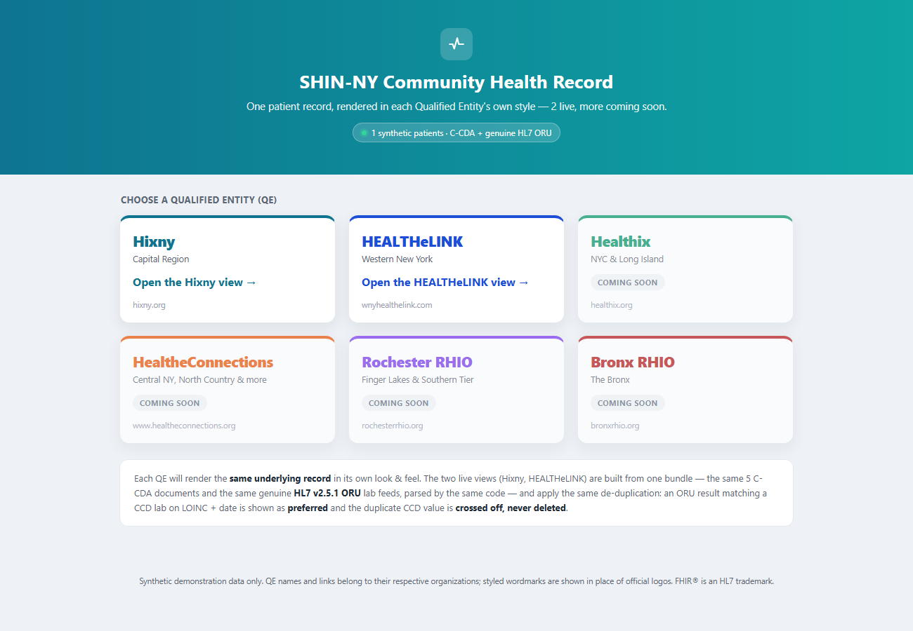
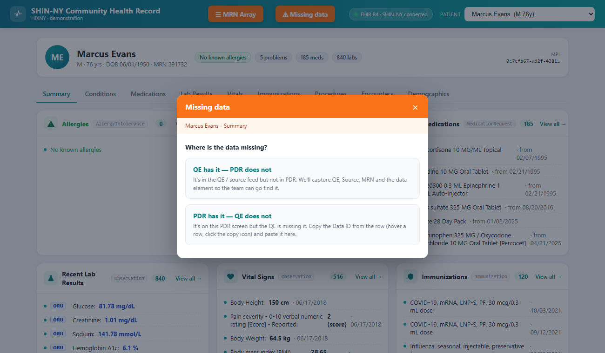
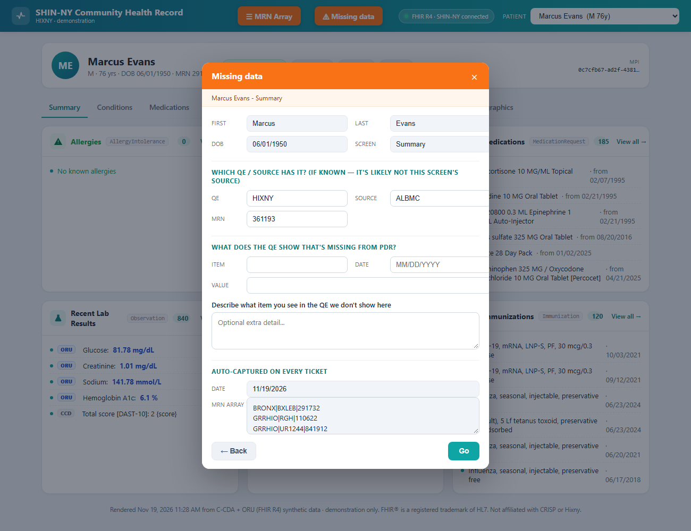
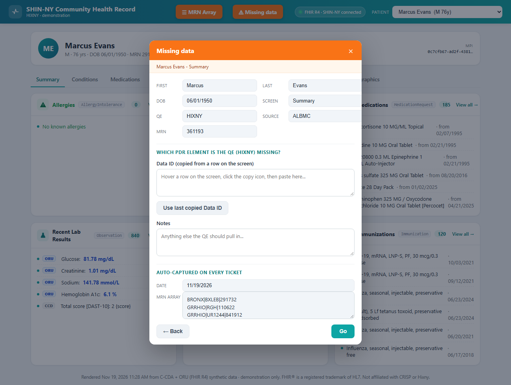
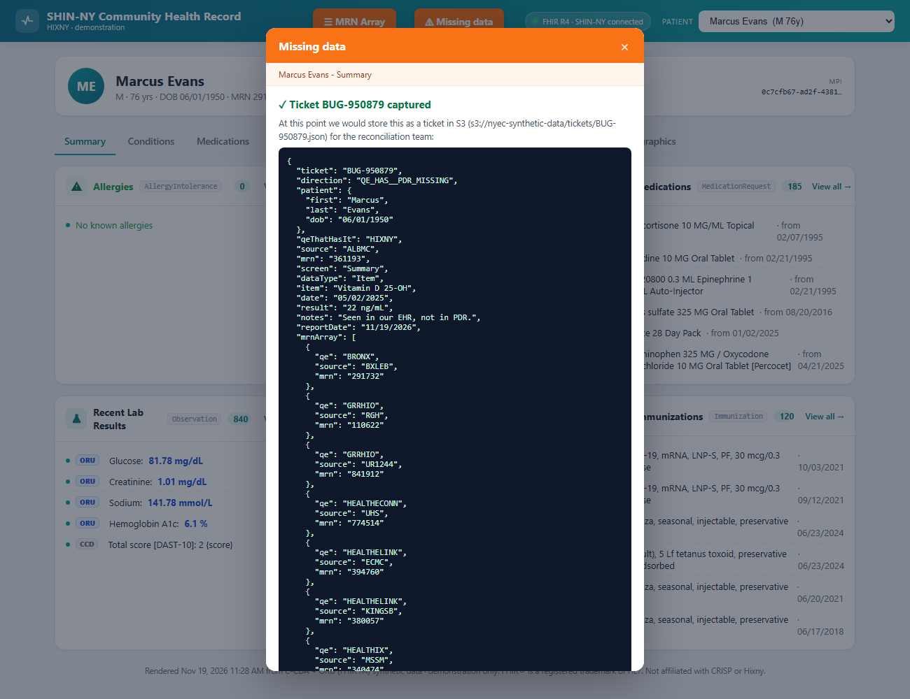
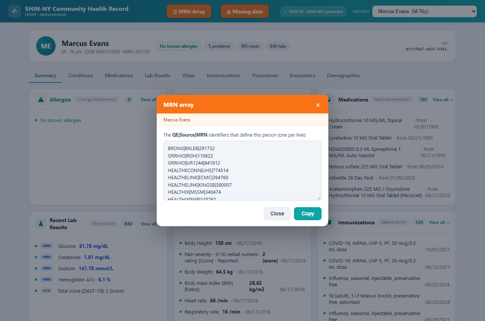

# Missing Data + MRN Array — Feature Build Spec

A build-ready specification so a fresh agent/engineer can reproduce this feature
**in a different code base**. It describes the behavior, the data model it needs,
the ticket schema, the S3/Athena storage requirement, and links to a working
reference implementation.

> PDR = the Patient Data Repository (what this portal shows).
> QE = a Qualified Entity / source feed (Healthix, HEALTHeLINK, Hixny, GRRHIO,
> Bronx RHIO, HealtheConnections, …). A **view** of the portal represents one QE
> (e.g. the "Hixny view").

The portal renders a merged patient record (data from PDR, one person across many QE sources). This feature adds two top-bar tools: **MRN Array** and **Missing data**. It is independent of how the data was obtained.

---

## 0. Screenshots

Images live in [`images/`](images/) (also in the repo at `developer-spec/images/`).

| State | Image |
|-------|-------|
| Home — one view per QE |  |
| Missing data — step 1, pick direction |  |
| Direction A — "QE has it, PDR doesn't" (QE auto-filled to the view's QE) |  |
| Direction B — "PDR has it, QE doesn't" |  |
| Ticket JSON on submit |  |
| MRN Array button + modal |  |

---

## 1. Top-bar buttons

Two buttons in the app bar of **every** patient view (both portal styles),
styled identically (orange):

- **⚠ Missing data** — opens the reconciliation modal (§3).
- **☰ MRN Array** — opens a modal listing the person's `QE|Source|MRN`
  identifiers, one per line, with a **Copy** button (§2).

## 2. MRN Array modal

- Header "MRN array", a context line with the patient name.
- A read-only, scrollable box listing every `QE|Source|MRN` that defines the
  person (see §7), one per line.
- **Copy** copies the whole list to the clipboard; **Close** / × / Esc /
  click-outside dismiss.

## 3. Missing data — step 1: direction

The modal first asks **"Where is the data missing?"** with two choices:

1. **QE has it — PDR does not** — it's in a QE/source feed but not in PDR.
2. **PDR has it — QE does not** — it's on this PDR screen but a QE is missing it.

`direction` is recorded on the ticket and drives the next step.

## 4. Direction A — "QE has it — PDR does not"

- **QE auto-fills to the QE whose view you are in** (e.g. in the Hixny view, QE
  defaults to `HIXNY`). **Source** and **MRN** auto-fill from that QE's matching
  identifier for this person when one exists; all three stay **editable** (the
  reporter can correct them).
- Identity (First, Last, DOB) and Screen are read-only.
- Data-hunt fields adapt to the current screen (§6): an item label
  (`Lab`/`Medication`/…), **Date**, and a result label. The notes prompt also
  adapts: *"Describe what `<datatype>` you see in the QE we don't show here."*

## 5. Direction B — "PDR has it — QE does not"

- Identity + Screen read-only.
- **QE/Source/MRN pre-filled (read-only) to the view's QE identifier** for this
  person. The section heading names the QE: *"Which PDR element is the QE
  (`<QE>`) missing?"*
- **Data ID** field: the reporter copies an ID from a row on the screen (§8) and
  pastes it, or clicks **Use last copied Data ID**.
- Notes.

## 6. Screen-adaptive field mapping (Direction A)

Default (unknown screen) = `Item` / `Value`.

| Screen | Item label | Result label | Item example | Result example |
|--------|-----------|--------------|--------------|----------------|
| Lab Results | Lab | Result | Hemoglobin A1c | 7.2 % |
| Medications | Medication | Dose / Status | Metformin 500 mg | Active |
| Conditions | Condition | Status | Type 2 diabetes | Active |
| Vitals / Vital Signs | Vital | Value | Blood pressure | 128/82 |
| Immunizations | Immunization | Status | Influenza | Completed |
| Allergies | Allergy | Reaction | Penicillin | Hives |
| Procedures | Procedure | Outcome | Appendectomy | — |
| Encounters | Encounter | Type | Hospital admission | — |
| Demographics | Demographic | Value | Phone number | — |

QE / Source / MRN are always present regardless of screen.

## 7. The person model (what makes MRN Array meaningful)

- A person's data (from many QE sources) is **merged into one virtual record** by a shared person key (a shared MPID when present, else `family|given|dob`).
- The **source identifiers that define the person** (`mrn_list`) are the union of every `(QE, Source, MRN)` triple across all sources, de-duplicated. Internal enterprise IDs (EID) and the MPID are excluded.
- **[Demo]** Each page carries the view's QE as `data-view-qe` on `<body>`, and each patient block carries `data-first/last/dob/qe/source/mrn/mrns` as HTML data attributes. **[Prod]** Pass QE context and the MRN array through the application state (not DOM attributes), and make it available to the Missing data widget at the point of use.

## 8. Copy-a-Data-ID from a row (Direction B helper)

- Every data row gets a subtle copy icon (on hover). Clicking copies a **Data ID** to the clipboard (Clipboard API over HTTPS; an in-memory "last copied" fallback works without it). The reporter pastes it into Direction B, or uses "Use last copied Data ID".
- **[Demo]** The Data ID is composed from row text: `PDR|mrn=…|qe=…|src=…|<cell> | <cell> | …`. This is fragile — it breaks if the row text changes after a data refresh.
- **[Prod]** Use a **stable record ID** assigned by PDR to each clinical item. The Data ID should be opaque to the user and survive data updates.

## 9. Auto-captured on EVERY ticket (read-only, both directions)

- **Date** — today's report date.
- **MRN array** — the full `QE|Source|MRN` set for the person (§7), shown as a
  read-only box and included in the payload as structured objects.

## 10. Dismissal

The modal closes without submitting via an **×** button, the **Escape** key, or
a click on the backdrop. Required on every step.

## 11. Ticket JSON schema

One ticket per submission. Keys are stable; nested only for `patient` and
`mrnArray`.

Common (all tickets):
- `ticket` (string) — short id, e.g. `BUG-950879`
- `direction` — `QE_HAS__PDR_MISSING` | `PDR_HAS__QE_MISSING`
- `patient` — `{ first, last, dob }`
- `screen` — `"<Section>"` (the screen the reporter was on)
- `reportDate` — local date of the report
- `mrnArray` — `[ { qe, source, mrn }, … ]`
- `notes` (string)
- `createdAt` — ISO-8601 UTC

Direction A adds: `qeThatHasIt`, `source`, `mrn`, `dataType`, `item`, `date`, `result`.
Direction B adds: `qeMissingIt`, `source`, `mrn`, `dataId`.

## 12. Storage requirement — secure S3 + Athena

Persist each ticket to S3 so Athena can report on them.

**Single-line JSON, NO indentation** (mandatory). Serialize with no
pretty-printing (`json.dumps(obj)` / `JSON.stringify(obj)` with no spacing). One
ticket = one JSON object on one line — Athena's JSON SerDe reads one record per
line; indented JSON will not parse.

**Layout (partitioned):**
`s3://<secure-tickets-bucket>/tickets/dt=YYYY-MM-DD/<ticket>.json`

**Secure bucket:** dedicated bucket, separate from any public/synthetic bucket;
Block Public Access ON; default encryption at rest (SSE-S3 min, SSE-KMS
preferred); bucket policy denying non-TLS (`aws:SecureTransport=false`);
versioning on; least-privilege IAM (writer = `s3:PutObject` to `tickets/*` only;
reader = Athena/Glue read).

**No browser writes.** A static page cannot hold AWS credentials. Add a thin
backend: `POST /tickets` → API Gateway → Lambda (role scoped to `PutObject` on
the tickets bucket) that validates and writes the compact JSON to the
partitioned key. The page `fetch`es the finished ticket object to that endpoint.

**Athena:** external table over `s3://<bucket>/tickets/` with
`org.openx.data.jsonserde.JsonSerDe`, partitioned by `dt`. Columns:
`ticket string, direction string,
patient struct<first:string,last:string,dob:string>, screen string,
qethathasit string, qemissingit string, source string, mrn string,
datatype string, item string, date string, result string, dataid string,
mrnarray array<struct<qe:string,source:string,mrn:string>>, notes string,
reportdate string, createdat string`. Add partitions via `MSCK REPAIR TABLE` or
partition projection on `dt`. Enables reports by direction, QE, screen/dataType,
day; most-reported missing elements; QE-vs-PDR gap counts.

## 13. Reference implementation (this repo: `rsxmjb234/Portal40-SideBySideV0`)

The feature ships as a self-contained injectable widget plus the merge/parse
support it reads from.

- [`bug_widget.py`](https://github.com/rsxmjb234/Portal40-SideBySideV0/blob/main/bug_widget.py)
  — the buttons, both modals, the per-row copy affordance, the client JS, and
  `inject(html)` which splices it into a finished page by string replacement
  (works regardless of the page's templating).
- [`ccda_parse.py`](https://github.com/rsxmjb234/Portal40-SideBySideV0/blob/main/ccda_parse.py) — **port only the merge and de-duplication functions**: `merge_by_person` (one virtual record per person), `_dedup_person` (collapses duplicates by type), `_reconcile_oru` (marks preferred/superseded between document and feed results). The parsing functions (`parse_ccd`, `load_oru_hl7`) read raw clinical files and are **not needed** in the new build.
- [`build_smart.py`](https://github.com/rsxmjb234/Portal40-SideBySideV0/blob/main/build_smart.py)
  and [`build_chart.py`](https://github.com/rsxmjb234/Portal40-SideBySideV0/blob/main/build_chart.py)
  — stamp `data-view-qe` on `<body>` and `data-first/last/dob/qe/source/mrn/mrns`
  on each patient block, call `merge_by_person`, and `inject` the widget.
- [`build_home.py`](https://github.com/rsxmjb234/Portal40-SideBySideV0/blob/main/build_home.py)
  — sets the per-view QE (`CHART_QE=HIXNY` / `HEALTHELINK`).

Porting notes for a different code base:
- You need, per rendered patient: name, DOB, and the person's `QE|Source|MRN`
  set; plus the current QE (the view) and the current screen/section name. Expose
  them however your framework prefers (data attributes, a JS global, props).
- The widget's logic is framework-agnostic vanilla JS; the only couplings are the
  DOM hooks it reads (`.patient[data-*]`, the active tab/section, `data-view-qe`)
  and the row copy target.

## 14. Acceptance criteria

- [ ] **MRN Array** and **Missing data** buttons on every patient view.
- [ ] MRN Array modal lists `QE|Source|MRN` (one per line) with Copy.
- [ ] Missing data step 1 offers the two directions; `direction` recorded.
- [ ] Direction A: **QE auto-fills to the current view's QE**; Source/MRN fill
      from the matching identifier; all editable.
- [ ] Direction B: QE/Source/MRN pre-filled read-only to the view's QE identifier;
      heading names the QE; Data ID paste + "use last copied".
- [ ] Item/Result labels, placeholders, and notes prompt adapt to the screen.
- [ ] Every ticket includes read-only `reportDate` and `mrnArray` (both directions).
- [ ] Modal closes via ×, Esc, backdrop without submitting.
- [ ] On submit the ticket is written to the secure S3 bucket as **single-line,
      no-indent JSON** under a `dt=`-partitioned key via the backend Lambda.
- [ ] An Athena table queries the tickets and produces reports.

All demo data is 100% synthetic.

