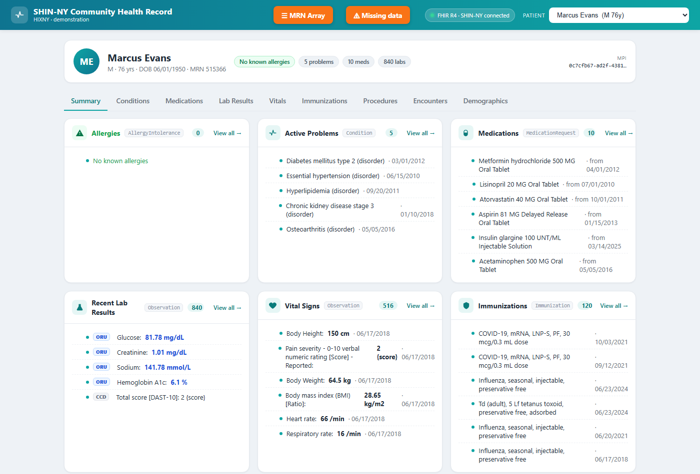
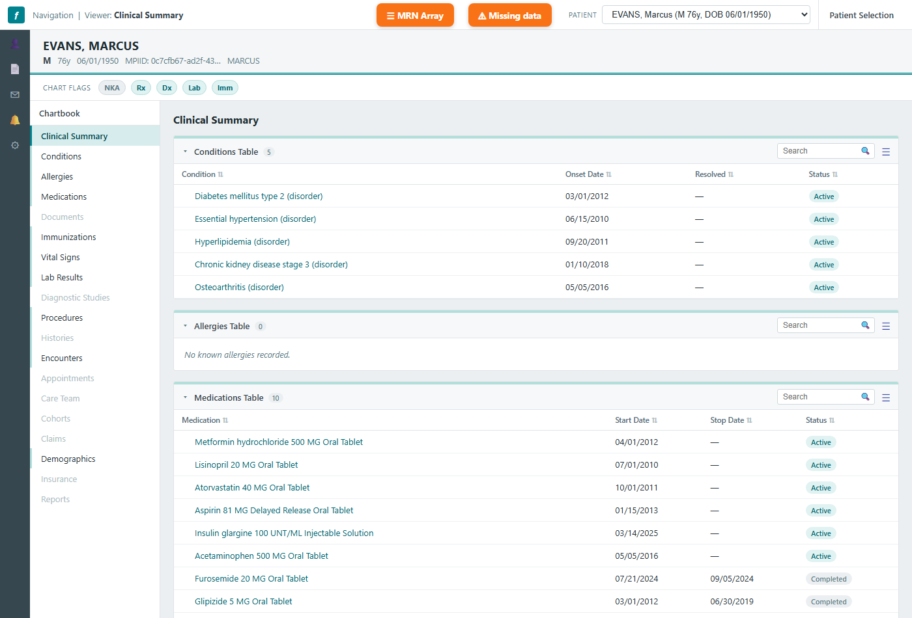
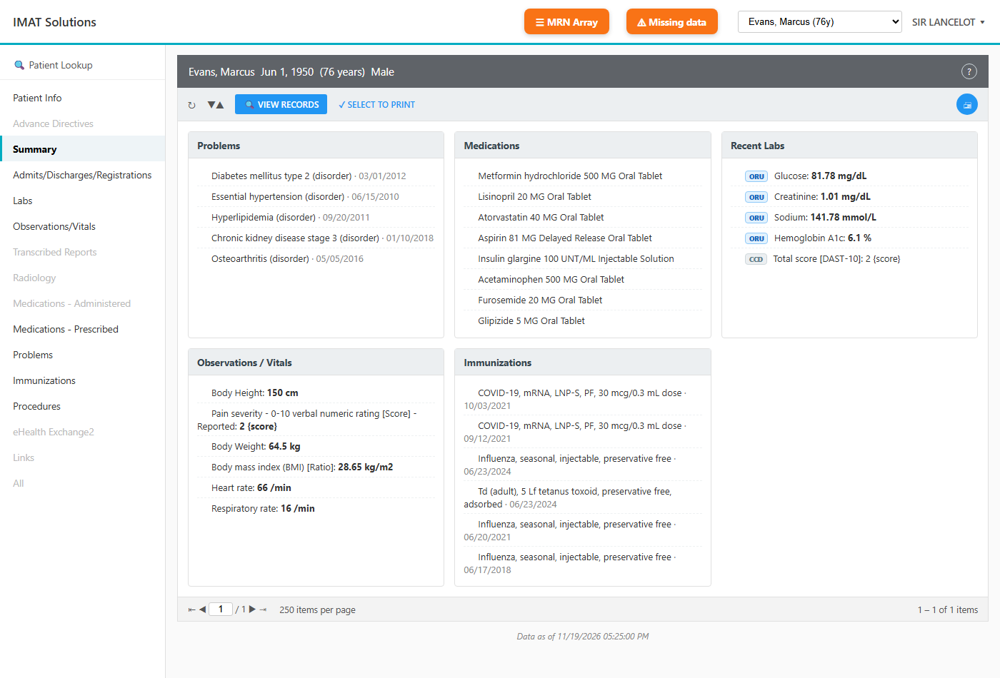
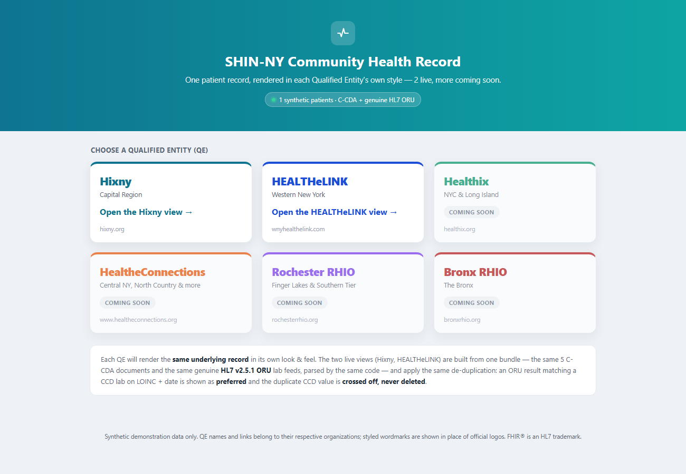

# 05 – UI Design Reference

Enough visual and interaction detail to recreate the three QE views and the shared widgets. Use together with the screenshots in `images/`. Where this text and a screenshot disagree, the screenshot wins.

| Screenshot | Shows |
|------------|-------|
| `images/home.png` | Home page |
| `images/view-hixny.png` | Hixny Summary tab |
| `images/view-healthelink.png` | HEALTHeLINK Clinical Summary |
| `images/view-bronx.png` | Bronx RHIO (IMAT) Summary |
| `images/mrn-array.png`, `step1-direction.png`, `step2a-qe-has-it.png`, `step2b-pdr-has-it.png`, `step3-ticket-json.png` | Missing data and MRN Array widgets |

Each QE view deliberately imitates that QE's own product. They do **not** share one theme. What they share is the data, the rules in doc 02, and the widgets in this document (section 5).

## 1. Hixny view

Style: modern card dashboard. Rounded cards, soft shadows, teal brand.

Design tokens: brand `#0ea5a4`, brand dark `#0b7c7b`, brand 2 `#0e7490`, orange accent `#f97316`, background `#eef2f6`, card `#fff`, ink `#1f2a37`, muted `#6b7280`, line `#e5e9ee`, blue `#1d4ed8`, danger `#dc2626`, ok `#16a34a`, warn `#b45309`. Font: Inter, falling back to system-ui / Segoe UI. Base size 14 px. Content max width 1180 px.

Layout, top to bottom:
1. **App bar**: gradient `#0e7490` to `#0ea5a4`, white text. Left: 34 px rounded logo mark (pulse icon), title "SHIN-NY Community Health Record", subtitle "HIXNY · demonstration" **[Demo — replace with real subtitle in production]**. Right: orange **MRN Array** and **Missing data** buttons, a pill "FHIR R4 · SHIN-NY connected" with a green dot **[Demo — remove or wire to real status]**, and a patient picker **[Demo — replace with search/EHR launch in production]**.
2. **Patient banner** (white card, 14 px radius): circular initials avatar with a teal gradient, name (20 px bold), meta line `M · 76 yrs · DOB 06/01/1950 · MRN 515366`, chips (`No known allergies` green, `5 problems`, `10 meds`, `840 labs`), and on the right a small monospace MPI value.
3. **Tab bar**: Summary, Conditions, Medications, Lab Results, Vitals, Immunizations, Procedures, Encounters, Demographics. Active tab: teal text with a 2.5 px teal underline.
4. **Summary**: 3-column grid of cards. Each card has a tinted icon, a bold title, a monospace gray **FHIR resource tag** pill, a count pill, and "View all →". Body is a bulleted list with the date in gray on the right. Cards: Allergies, Active Problems, Medications, Recent Lab Results, Vital Signs, Immunizations. "Recent Lab Results" lists ORU results first with a blue **ORU** badge, then CCD results with a gray **CCD** badge.
5. **Detail tabs**: a single table per tab with a header row; chips for status (green Active, gray Completed), a blue "preferred" chip and an amber "superseded by ORU" chip on labs.

## 2. HEALTHeLINK (Fusion) view

Style: dense enterprise clinical viewer.

Tokens: teal `#00838f`, teal dark `#006974`, teal light `#b2dfdb`, selected `#d7ecec`, indigo `#3f51b5`, ink `#263238`, muted `#607d8b`, line `#e0e4e7`, background `#eceff1`, red `#c62828`. Font: Segoe UI / Roboto, 13 px.

Layout:
1. **App bar** (46 px, white): logo tile ("f", teal, italic), "Navigation | Viewer: Clinical Summary", orange MRN Array and Missing data buttons, patient picker (`EVANS, Marcus (M 76y, DOB 06/01/1950)`), "Patient Selection".
2. **Left rail** (46 px, dark `#37474f`): icon column.
3. **Banner** (`#f5f6f7`): uppercase name `EVANS, MARCUS` at 18 px, a second line with sex, age, DOB, MPIID (truncated) and a short label. Under it a 4 px teal gradient divider.
4. **Chart flag bar**: label "CHART FLAGS" then pills. NKA gray, Dx / Rx / Lab / Imm teal, allergy count red.
5. **Chartbook** (200 px, white): section list. Sections with data have a teal left border and dark text; the selected item has a teal background and bold text; empty sections are light gray and inert. One section shows at a time.
6. **Content**: section title, then cards. Each card has a 4 px light-teal accent, a header with a collapse chevron, title, gray count badge, a search box with a magnifier, and a three-bar filter icon. Tables have sortable column headers (sort icon), rows with blue-teal link text for the item name, thin row dividers, and a green "Active" or gray "Completed" status pill.
7. Abnormal labs: red value, red left bar. Superseded CCD labs: strikethrough with a "superseded by ORU" tag. ORU group first, with a header band and result count.

## 3. Bronx RHIO (IMAT) view

Style: plain, utilitarian. White page, cyan rule under the header.

Tokens: header rule `#00acc1`, banner gray `#5f6368` with white text, toolbar `#eceff1`, action blue `#2196f3`, table header `#e6eaed`, zebra `#f5f7f8`, row hover `#eef4f7`, ORU tint `#f3f9ff`, ORU group `#e3f2fd` on `#0d47a1`, abnormal red `#c62828`, disabled nav `#bbb`. Font: Segoe UI / Arial, 13.5 px.

Layout:
1. **App bar**: "IMAT Solutions" at left, orange buttons, patient picker, user menu "SIR LANCELOT ▾" (demo placeholder, replace with the signed-in user).
2. **Left nav** (232 px): "Patient Lookup", then the section list from [qe/bronx-rhio.md](qe/bronx-rhio.md). Selected item is bold with a cyan left border and light-blue background. Disabled items are gray.
3. **Patient banner** (gray bar): `Evans, Marcus  Jun 1, 1950 (76 years)  Male`, and a round help icon at right.
4. **Toolbar**: refresh, expand/collapse arrows, blue **VIEW RECORDS** button, "✓ SELECT TO PRINT", round blue print button at right.
5. **Summary**: grid of cards (Problems, Medications, Recent Labs, Observations / Vitals, Immunizations). Card header is gray bold text; body is a list with the date in gray.
6. **Tables** elsewhere: leading magnifier column, gray header, zebra rows. Group rows (panel names, the ORU feed) are darker bands.
7. **Pager bar** under the panes: `1 / 1`, "250 items per page", "1 – 1 of 1 items". **Footer**: italic "Data as of <timestamp>".

## 4. Home page

Tokens: brand `#0ea5a4`, brand 2 `#0e7490`, background `#eef2f6`, line `#e5e9ee`. Card: white, 14 px radius, 4 px top border in the QE color, shadow. Full requirements in [01-home-page.md](01-home-page.md).

## 5. Shared widgets (identical in all three views)

### Buttons
- **MRN Array** and **Missing data**: orange `#f97316`, white bold text 13.5 px, 8 px radius, padding 9×16, soft shadow, hover `#ea580c`. They sit in the app bar, right of the spacer, before the patient picker.
- Missing data label: `⚠ Missing data`. MRN Array label: `☰ MRN Array`.

### Modals (Missing data, MRN Array)
Fixed full-screen overlay `rgba(15,23,42,.5)`, centered white card, 14 px radius, 540 px wide (MRN Array 460 px), max 92% viewport height, scrolls inside. Orange header band with a title and a × close. Closes on ×, Esc, or a click on the backdrop. Full field list and flow: [03-missing-data-logging.md](03-missing-data-logging.md).

### Per-row copy icon
A small `⧉` in the first cell of every data row and every summary-list item. Hidden until row hover (gray, teal on hover). Click copies the Data ID and shows a dark pill toast at the bottom center: "Data ID copied — open "Missing data" → PDR has it, then paste". The copy click must not open the drill-in.

### Drill-in detail modal
- Opens on a click on any data row, except group-header rows and the copy icon.
- 580 px wide card. **Blue header** (`#2196f3`) titled `<Section> – detail`. Under it a light-blue strip with `Name · DOB mm/dd/yyyy · QE|Source MRN nnnn`.
- Body: a two-column table, label (gray, 190 px wide) and value. Visible columns of the clicked row come first (in table order, skipping the icon column), then the extra fields from doc 02, section 9. Empty values are skipped for extras.
- Close button bottom right, plus ×, Esc and backdrop click.
- Rows show a pointer cursor.

### Auto-fill rule
Each view declares its QE (`data-view-qe` attribute on the page body in the demo). Missing data auto-fills QE from it. MRN Array reads the person's MRN array. See doc 03.

## 6. Demo-only controls to remove or replace

- The **patient picker** dropdown at the top of each view. In production the patient comes from search or EHR launch.
- The static user label ("SIR LANCELOT").
- The "FHIR R4 · SHIN-NY connected" pill (Hixny) is decoration. Remove or wire to real status.
- "Data as of" in the Bronx footer is a build-time stamp. Use the real data timestamp.
